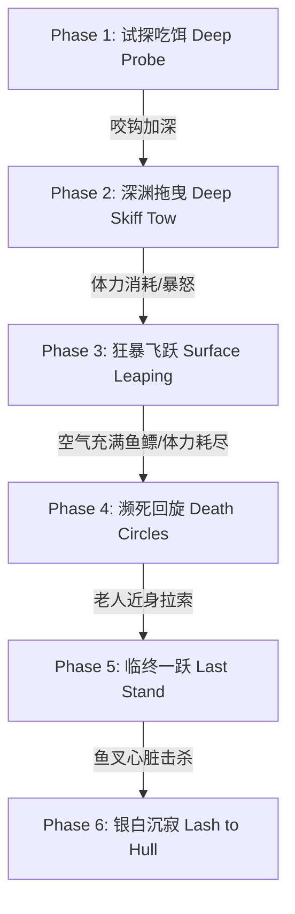

# 《老人与海》Unity Web 游戏资产与 AI 提示词库 (Prompt Dictionary)

> 本文档基于海明威原著《The Old Man and the Sea》全部文本细节精炼构建，专为 Unity Web 游戏开发定制。涵盖老人圣地亚哥（Santiago）、大马林鱼（Giant Marlin）、敌对鲨鱼群的视觉概念提示词（Midjourney/SDXL/PBR）、3D资产规范、动画状态机指令以及 Unity LLM/NPC 心理独白系统 Prompt。

---

## 目录
1. [角色一：老渔夫圣地亚哥 (Santiago) 全套提示词](#角色一老渔夫圣地亚哥-santiago-全套提示词)
   - 1.1 [原著外貌与设定精要提炼](#11-原著外貌与设定精要提炼)
   - 1.2 [2D/3D概念美术与贴图生成提示词 (Midjourney / SDXL)](#12-2d3d概念美术与贴图生成提示词-midjourney--sdxl)
   - 1.3 [Unity PBR材质与Low-Poly/次表面散射着色规范](#13-unity-pbr材质与low-poly次表面散射着色规范)
   - 1.4 [角色动画与动作捕捉提示词 (Unity Animator)](#14-角色动画与动作捕捉提示词-unity-animator)
   - 1.5 [NPC与心理独白系统 LLM Prompt (人格与台词生成)](#15-npc与心理独白系统-llm-prompt-人格与台词生成)
2. [角色二：巨大马林鱼 (The Giant Marlin) 全套提示词](#角色二巨大马林鱼-the-giant-marlin-全套提示词)
   - 2.1 [原著生物结构与色彩细节提炼](#21-原著生物结构与色彩细节提炼)
   - 2.2 [视觉概念与3D模型生成提示词](#22-视觉概念与3d模型生成提示词)
   - 2.3 [Boss行为状态机与动画提示词 (FSM / Behavior Tree)](#23-boss行为状态机与动画提示词-fsm--behavior-tree)
   - 2.4 [水下特效 (VFX) 与物理粒子提示词](#24-水下特效-vfx-与物理粒子提示词)
3. [敌对生物：鲨鱼群体 (The Sharks) 提示词](#敌对生物鲨鱼群体-the-sharks-提示词)
   - 3.1 [灰鲭鲨 (Mako / Dentuso) 视觉与AI提示词](#31-灰鲭鲨-mako--dentuso-视觉与ai提示词)
   - 3.2 [犁头角鲨 (Galano) 视觉与AI提示词](#32-犁头角鲨-galano-视觉与ai提示词)
4. [环境与物件提示词库 (Environment & Props)](#环境与物件提示词库-environment--props)
   - 4.1 [小艇 (The Skiff) 与 破损面粉袋补丁帆](#41-小艇-the-skiff-与-破损面粉袋补丁帆)
   - 4.2 [墨西哥湾流 (Gulf Stream) 动态海域与光影](#42-墨西哥湾流-gulf-stream-动态海域与光影)

---

## 角色一：老渔夫圣地亚哥 (Santiago) 全套提示词

### 1.1 原著外貌与设定精要提炼
* **体态特征**：消瘦、憔悴（thin and gaunt），颈后有深刻的皱纹（deep wrinkles in back of neck）。
* **面部细节**：双颊与面庞两侧生有阳光反射在热带海面长期照射所致的褐色良性皮肤癌斑（brown blotches of benevolent skin cancer）。双眼如同海水一般湛蓝，眼神欢快且永不认输（eyes the same color as the sea, cheerful and undefeated）。
* **双手状态**：布满常年拉扯粗重钓绳勒出的深凹伤痕（deep-creased scars），伤痕陈旧如无鱼沙漠中的风化侵蚀；在出海作战期间，左手频发严重抽筋扭曲成鹰爪状（cramp / calambre），右手被高速掠过的钓绳割破流血。
* **衣着与装备**：粗布长裤（卷至膝盖，沾满海盐结晶与鱼鳞）、褪色磨损的旧衬衫（布满面粉袋修补的补丁，patched with flour sacks）、破草帽（straw hat）、赤足（barefoot）。肩部压着沉重钓索留下的勒痕。

---

### 1.2 2D/3D概念美术与贴图生成提示词 (Midjourney / SDXL)

#### A. 角色肖像与特写 (Headshot & Facial Expression)
```text
Prompt:
masterpiece, 8k resolution, stylized realistic character portrait of Santiago, the old Cuban fisherman from The Old Man and the Sea. An elderly man in his late 60s, extremely thin and gaunt face, deeply sun-weathered dark bronze skin, deep rugged wrinkles carved into the back of his neck and forehead. Cheeks covered with fading brown sun-spots and freckles. Striking, luminous ocean-blue eyes, piercing gaze filled with iron willpower, dignity, resilience, undefeated spirit. Silver-gray stubble beard, unkempt white thinning hair under a battered tattered straw hat. Soft golden-hour tropical sunlight hitting the side of his face, sea salt crystals glinting on worn skin, cinematic depth of field, Rembrandt lighting, Unreal Engine 5 render style, artstation trending.
--ar 3:4 --stylize 250 --v 6.0

Negative Prompt:
smooth skin, youthful, cartoon, anime, smiling happily, weak, despairing, weeping, modern clothing, sunglasses, messy geometry, extra eyes, deformed.
```

#### B. 角色全身像与动作立绘 (Full Body Concept Art)
```text
Prompt:
full body character concept art of Santiago, old man fisherman standing on a small 16-foot wooden skiff in the open ocean. Gaunt athletic wiry frame, sinewy arms with prominent veins and old cord scars across his rough hands and knuckles. Wearing a faded off-white vintage linen work shirt patched with dusty flour sack cloth, rolled-up brown canvas trousers worn at the hems, barefoot with weathered feet gripping the wet wooden thwarts. A thick coil of dark brown tarred fishing cord wrapped across his sinewy back and shoulders. Grim determined posture, leaning against the ocean gale. Backdrop of turbulent Gulf Stream deep blue water, spray of ocean foam, dramatic clouds at dawn, high dynamic range, heroic low-angle composition.
--ar 9:16 --stylize 300 --v 6.0
```

#### C. 手部特写概念（关键游戏状态：抽筋与拉绳伤痕）
```text
Prompt:
extreme macro close-up of an old fisherman's hands gripping a taut, vibration-humming thick green fishing cord. The left hand is painfully curled into an involuntary rigid claw cramp (calambre), stiffened knuckles, tense white sinews. The right hand has raw rope burns and bleeding diagonal cuts across the palm and index finger, glistening with salt water and fish blood. Weathered leathery skin, dark sun spots, chipped fingernails with dried blood beneath. Hyper-realistic texture, tactile sensation of tension and pain, 8k photorealistic macro lens.
--ar 16:9 --stylize 200 --v 6.0
```

---

### 1.3 Unity PBR材质与Low-Poly/次表面散射着色规范

* **Unity Shader 选型建议**：URP Lit Shader 或 Custom SSS Subsurface Shader（适用于 WebGL 性能开销控制）。
* **材质参数配置表**：

| 贴图槽位 (Slot) | 贴图规格 | 描述与原著细节映射 |
| :--- | :--- | :--- |
| **Albedo / Base Map** | 2048x2048 (Web压缩为1024) | 古铜色海风暴晒肤色 `#8A5232`，面部叠加褐色老年斑 `#4E2A18`，深邃海蓝色虹膜 `#1A5B8C`，衣物为面粉袋拼接粗布白 `#D8CEBC`。 |
| **Normal Map** | 1024x1024 | 刻画颈部刀劈般的老年褶皱、手掌勒痕沟壑、粗麻布粗糙纤维纹理。 |
| **Metallic / Roughness** | 1024x1024 | 皮肤 Roughness 保持在 0.55-0.7（干燥粗糙）；汗水/海水喷溅部分通过顶点色通道或动态 Mask 降低 Roughness 至 0.05（高光潮湿反光）。 |
| **Subsurface Mask** | 512x512 | 耳廓、手指边缘薄处红润透光（在夕阳照射下拉索透出微弱暗红色透光感）。 |

---

### 1.4 角色动画与动作捕捉提示词 (Unity Animator)

在 Unity Web 中，老人的动作机（Animator Controller）由以下核心状态组成。用于生成动画资产或提示 mocap/动画师：

```json
{
  "Character_States": [
    {
      "State_Name": "Rowing_Skiff_Loop",
      "Description": "坐在中座划双桨，身体前后韵律倾斜，动作沉稳老练，手部与脚掌紧扣船板",
      "Keywords": "seated rowing skiff, rhythmic steady stroke, veteran posture, gripping oars, ocean sway resistance"
    },
    {
      "State_Name": "Line_Tension_Idle",
      "Description": "双腿分立微曲，双手将沉重钓绳横穿后背受力，抵抗前方巨物持续拖拽，面部紧绷",
      "Keywords": "heavy cord across back and shoulders, bracing against forward pull, isometric muscle tension, grim determination"
    },
    {
      "State_Name": "Left_Hand_Cramp_React",
      "Description": "左手突然抽搐痉挛成爪状，老人咬牙忍痛，用右手和膝盖强顶钓线，低头搓揉左手",
      "Keywords": "sudden hand muscle spasm, painful grimace, dropping one hand, rubbing stiff fingers, desperation"
    },
    {
      "State_Name": "Eat_Raw_Fish_Bonito",
      "Description": "蹲伏在船艏，用短刀割下带血生鱼肉，强忍恶心细细咀嚼以补充体力",
      "Keywords": "crouching in boat, cutting raw fish with knife, chewing raw tuna slowly, endurance survival"
    },
    {
      "State_Name": "Harpoon_Raise_And_Thrust",
      "Description": "高潮处决技：立于船头摇晃中高举铁制飞叉，用全身残存体重与爆发力垂直猛扎向下",
      "Keywords": "standing on rolling bow, high overhead two-handed harpoon raise, explosive downward thrust, full body weight strike"
    },
    {
      "State_Name": "Shark_Clubbing_Melee",
      "Description": "双手持木棍/舵柄，朝着靠舷撕咬的鲨鱼头部与吻部猛烈砸击，动作粗暴急促",
      "Keywords": "swinging heavy wooden club, two-handed downward strikes, hitting shark snout, breathless combat"
    },
    {
      "State_Name": "Exhausted_Trudge_Mast",
      "Description": "战役尾声：肩扛沉重船桅与卷起的残帆，赤脚在碎石坡上五次步履蹒跚踉跄倒地再爬起",
      "Keywords": "carrying heavy mast on shoulder, exhausted staggering, stumbling, falling to knees, rising slowly"
    }
  ]
}
```

---

### 1.5 NPC与心理独白系统 LLM Prompt (人格与台词生成)

当游戏中接入轻量端侧或 Web API 大模型驱动老人的动态实时内心独白时，使用以下系统提示词设定：

```text
[System Role: Santiago - The Old Man]
You are Santiago, the aging Cuban fisherman from Ernest Hemingway's masterpiece "The Old Man and the Sea". You speak with quiet, austere dignity, stripped of flowery metaphors, using lean, visceral, and stoic language. Your thoughts alternate between acute sensory awareness of the sea (La Mar), profound respect and love for the creature you must kill, and internal dialogues that keep you conscious through pain and exhaustion.

Key Mental Anchors & Persona Rules:
1. "La Mar": You think of the sea as a woman, feminine, generous, and capricious, not an enemy.
2. Brotherhood with the Fish: You admire the giant marlin ("I love you and respect you very much. But I will kill you dead before this day ends."). You do not hate your prey.
3. Psychological Pillars: When your body falters, you conjure memories of:
   - The young lions playing on the golden beaches of Africa at twilight.
   - The Great Joe DiMaggio, who plays with agonizing bone spurs in his heel.
   - The 24-hour arm-wrestling contest in Casablanca tavern against the mighty Negro from Cienfuegos, where your fingertips bled onto the wood until you won.
4. Physical Strain Realism: Acknowledge your cramping left hand ("calambre"), the rope burns on your palms, the sun glare burning your eyes, thirst, and dizziness.
5. Hemingway Tone: Keep responses concise, rhythmic, simple nouns and verbs, zero modern slang, deep humility without defeatism ("Man is not made for defeat. A man can be destroyed but not defeated.").

Game Context Trigger: Current Tension = {Tension_Level}, Stamina = {Stamina_Percent}, Combat Phase = {Combat_Phase}.
Generate a single short internal monologue (1-3 sentences) reflecting your physical state and unyielding will.
```

---

## 角色二：巨大马林鱼 (The Giant Marlin) 全套提示词

### 2.1 原著生物结构与色彩细节提炼
* **体长与尺寸**：体长达到整整 18 英尺（约 5.5 米，比老人的 16 英尺小木艇还要长出两英尺！nose to tail 18 feet）。
* **吻剑 (Bill / Sword)**：修长如棒球棍般粗细，末端如轻剑般锋利修长（as long as a baseball bat and tapered like a rapier）。
* **背鳍与尾鳍**：背鳍展开如巨大暗紫色的镰刀（scythe-like dorsal fin）；尾鳍巨大呈完美的新月形（huge sickle-shaped tail），摆动时拍打出巨大的白色水涌。
* **体色与纹理**：
  - 潜伏深海时：深邃幽暗的深海靛蓝。
  - 破水腾跃时：身侧浮现出奇异耀眼的**淡紫色横斑条纹（lavender / light purple stripes）**，在日光下折射出虹彩。
  - 腹部与死后：巨大的胸鳍如同展开的鸟翼，腹部呈现冰冷无瑕的银白色（burnished silver belly）。
* **眼神神态**：巨大的暗金/黑曜石眼眸，沉静、高贵，不带慌乱，与垂死的挣扎形成庄严的反差。

---

### 2.2 视觉概念与3D模型生成提示词

#### A. 马林鱼水中游动与巨物感 (Aquatic Giant Scale Concept)
```text
Prompt:
epic dynamic shot of a colossal 18-foot Atlantic Blue Marlin swimming right beside a small weathered wooden skiff in the crystal-clear deep azure waters of the Gulf Stream. The marlin is enormous, two feet longer than the boat, with a sleek hydrodynamic body, vivid wide lavender and electric-purple vertical stripes glowing across its dark cobalt sides. Its elongated bill tapers like a lethal black rapier sword, gigantic dark sickle-shaped dorsal fin slicing through the surface film. Water caustic god-rays filtering through the ocean depths, micro-bubbles streaming along its glistening scales, cinematic low-angle underwater perspective emphasizing terrifying scale, photorealistic 8k, Unreal Engine 5 water rendering.
--ar 16:9 --stylize 350 --v 6.0
```

#### B. 破水飞跃绝景 (The Epic Breach / Jump)
```text
Prompt:
masterpiece action shot, a legendary giant marlin leaping entirely out of the ocean into the air against the backdrop of an amber tropical sunrise. The fish is frozen mid-air, twisting its massive muscular 18-foot silver-and-purple body, water violently exploding around it in sheets of shimmering spray. The huge sickle tail flexes, droplets glinting like diamonds in the dawn light. In the foreground, an old solitary fisherman clinging to a taut vibrating rope in a tiny rocking boat, awe-struck composition, high speed shutter photography, National Geographic ocean documentary aesthetic.
--ar 21:9 --stylize 300 --v 6.0
```

---

### 2.3 Boss行为状态机与动画提示词 (FSM / Behavior Tree)

在 Unity 中，马林鱼作为顶级 Boss 实体，其状态机分为 6 个阶段（Phases）：



```json
{
  "Boss_Marlin_States": [
    {
      "Phase": "Phase_1_Deep_Probe",
      "Depth": "100 fathoms (约180米)",
      "Behavior": "轻微触碰沙丁鱼与金枪鱼饵，轻微牵引绿色钓绳，进行三次试探性咬合",
      "Animation_Prompt": "subtle nibbling motion, gentle pectoral fin steering, slow drifting at abyss"
    },
    {
      "Phase": "Phase_2_Deep_Skiff_Tow",
      "Depth": "40 - 80 fathoms",
      "Behavior": "匀速游动，背对小艇向东北方向持续拉曳，绝不浮出水面，以绝对质量对抗老人耐力",
      "Animation_Prompt": "relentless steady rhythmic tail oscillation, head fixed forward, towing heavy tension load"
    },
    {
      "Phase": "Phase_3_Surface_Leaping",
      "Depth": "0 - 10 fathoms",
      "Behavior": "连续数十次暴烈破水腾空跳跃，甩头试图震脱口中弯钩，并在空中展现18英尺全貌让鱼鳔充气",
      "Animation_Prompt": "explosive vertical breaching jump, violent head thrashing in mid-air, twisting body arc, heavy splashdown"
    },
    {
      "Phase": "Phase_4_Death_Circles",
      "Depth": "Surface to 15 fathoms",
      "Behavior": "围绕小艇做大半径同心圆环绕游动，每一圈半径缩小2米，游速渐慢，偶尔露出侧翻银白肚皮",
      "Animation_Prompt": "slow banking circular swim, tilted body revealing silver underbelly, sluggish fin correction"
    },
    {
      "Phase": "Phase_5_Last_Stand",
      "Depth": "Surface alongside boat",
      "Behavior": "被老人强行拉近船舷，突然发出最后一击冲刺，贴着小木船破浪而出，悬浮在老人头顶上空",
      "Animation_Prompt": "sudden towering breach right beside gunwale, shadow cast over old man, agonizing shudder as harpoon impacts"
    },
    {
      "Phase": "Phase_6_Lash_To_Hull",
      "Depth": "Surface water",
      "Behavior": "死后肚皮朝天，眼眸转为平静沉银，巨大身躯沿小艇右舷被粗绳严密绑缚，随浪涛平稳起伏",
      "Animation_Prompt": "lifeless floating alongside wooden hull, gentle ocean wave buoyancy physics, rope tight binding"
    }
  ]
}
```

---

### 2.4 水下特效 (VFX) 与物理粒子提示词

* **VFX_Line_Tension_Hum (钓线高频振荡特效)**：
  - 视觉表现：深绿色尼龙/线绳紧绷至极点，周围产生极细微的高频空气与水花飞溅粒子，伴随水珠高速滑落效果。
  - WebGL 优化：使用简单的 LineRenderer 配套高频正弦位移顶点 Shader。
* **VFX_Marlin_Purple_Pulse (马林鱼愤怒/发光条纹)**：
  - 当大鱼进入发力冲刺状态，体侧紫色条纹的 Emission 材质通道从 `#2E0854` 瞬间升压至带荧光的 `#9D00FF`。
* **VFX_Harpoon_Impact_Cloud (心脏穿刺与血雾扩散)**：
  - 鱼叉刺入胸鳍后方，从创口喷涌出浓郁的暗红色血云（dark cloud of heart blood），在深蓝海水里像墨汁般缓缓盘旋下沉，引出后续的鲨鱼追踪机制。

---

## 敌对生物：鲨鱼群体 (The Sharks) 提示词

### 3.1 灰鲭鲨 (Mako / 原著称 Dentuso) 视觉与AI提示词
* **生物特征**：巨大的古巴灰鲭鲨，凶猛、迅疾、体态优雅。背部呈如剑鱼般美丽的深青蓝色，背脊与尾鳍如导弹推进器；口中排列着八行向内弯曲、如人类鹰爪手指般尖锐的黄白色利齿（teeth shaped like a man's fingers crisped like claws）。
* **AI 行为逻辑**：
  - **直线冲刺 (Direct Torpedo Charge)**：嗅着血云以极高航速直冲船侧的马林鱼肉。
  - **弱点**：双眼之间的大脑十字中枢（Brain target point）。
* **Midjourney 概念图 Prompt**：
  ```text
  Prompt:
  action underwater close-up of a monstrous Mako shark (Dentuso) surging toward the viewer with jaw open wide, terrifying rows of curved white claw-like razor teeth visible, deep cobalt-blue hydrodynamic back, sleek muscular predator form, piercing dead yellow eyes, high speed water currents, ocean blood plume in background, cinematic horror, 8k render.
  --ar 16:9 --v 6.0
  ```

---

### 3.2 犁头角鲨 (Galano / 铲鼻食腐鲨) 视觉与AI提示词
* **生物特征**：成对出现的棕褐色铲头角鲨（shovel-nosed scavenger sharks），宽大扁平的头部像铁铲，胸鳍展开像宽阔的铁锹，散发着恶臭与贪婪，专门撕扯猎物下盘。
* **AI 行为逻辑**：
  - **包抄撕咬 (Pincer Attack)**：一只从水下潜入鱼肚盲区，另一只在水面翻滚撕扯。
  - **反制打击**：老人的鱼叉已失，需使用**绑在船桨上的刮胡刀/短刀（Knife on Oar）**或**断木棍（Club）**瞄准其坚硬的吻部与脊柱猛击。
* **Midjourney 概念图 Prompt**：
  ```text
  Prompt:
  two repulsive shovel-nosed brown scavenger sharks (Galano) circling and gnawing violently at the carcass of a giant marlin lashed to a wooden skiff. Wide flattened brown heads, sickly yellow reptilian eyes, broad shovel-like pectoral fins slicing murky water, raw violent ocean feeding frenzy, splashing red-tinted water, realistic dynamic lighting.
  --ar 16:9 --v 6.0
  ```

---

## 环境与物件提示词库 (Environment & Props)

### 4.1 小艇 (The Skiff) 与 破损面粉袋补丁帆
* **原著描绘**：长 16 英尺的小木船，经受数十年盐水浸润呈银灰色脱漆质感。单桅，帆布是用装过面粉的布袋缝补的，卷起来时“像一面标志着永久失败的旗帜”（patched with flour sacks, looked like the flag of permanent defeat）。
* **道具清单 Prompt**：
  ```text
  Prompt:
  prop asset sheet of a vintage 1940s Cuban fishing skiff, 16-foot weathered wooden boat, silver-gray sun-bleached wood planks, patches of peeled sea-green paint. A single wooden mast with rolled sail patched with labeled flour sacks, two worn wooden oars in rowlocks, a wooden tiller attached to rudder, coiled green braided fishing lines in round wicker baskets, a rusted iron harpoon with hemp rope, a notched wooden gaff, a heavy wooden club for fish killing, Unity game-ready prop, clean white background.
  --ar 16:9 --v 6.0
  ```

### 4.2 墨西哥湾流 (Gulf Stream) 动态海域与光影
* **昼夜时间流逝 Prompt**：
  - **黎明深蓝 (Dawn Abyss)**：`Deep indigo-blue sea, pitch-black deep water, faint phosphorescence glowing in the oars' wake, Venus star fading in morning twilight.`
  - **正午酷阳 (Scorching Noon)**：`Blinding white tropical sun reflection, mirage heat haze on horizon, translucent turquoise water clarity revealing abyss below, sweat-inducing glare.`
  - **夜间星海 (Starry Midnight Battle)**：`Dark midnight waters, Rigel and the Belt of Orion visible in clear night sky, bioluminescent green plankton sparks in the churning wake, sinister dark shark fins cutting through moonlit waves.`
