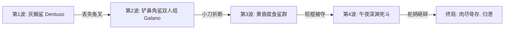

# 《老人与海》Unity Web 游戏全主线叙事与关卡推进设计 (Storyline & Level Progression)

> 本文档完整映射欧内斯特·海明威《老人与海》全书情节脉络，将其精准重构为适配 WebGL / Web 端的 7 幕式关卡体验。兼顾硬汉文学的主题深度与游戏化机制的张弛节奏（心流设计）。

---

## 目录
1. [游戏化总体架构与叙事哲学](#1-游戏化总体架构与叙事哲学)
2. [第0幕：【出航前夜·84日的厄运】(Prologue)](#第0幕出航前夜84日的厄运prologue)
3. [第1幕：【破晓深航·百寻之渊】(Act-I)](#第1幕破晓深航百寻之渊act-i)
4. [第2幕：【无声拉锯·深渊拖曳】(Act-II)](#第2幕无声拉锯深渊拖曳act-ii)
5. [第3幕：【巨兽腾跃·荣耀回忆】(Act-III)](#第3幕巨兽腾跃荣耀回忆act-iii)
6. [第4幕：【生死回旋·绝杀大鱼】(Act-IV)](#第4幕生死回旋绝杀大鱼act-iv)
7. [第5幕：【血路残骸·群鲨狂潮】(Act-V)](#第5幕血路残骸群鲨狂潮act-v)
8. [第6幕：【未败之骨·狮子之梦】(Epilogue)](#第6幕未败之骨狮子之梦epilogue)
9. [关卡推进状态机与数值承接总表](#9-关卡推进状态机与数值承接总表)

---

## 1. 游戏化总体架构与叙事哲学

### 1.1 核心母题：毁灭与不败
游戏整体围绕海明威名言展开：
> **“A man can be destroyed but not defeated.”**（人可以被毁灭，但不能被打败。）

在 Unity Web 游戏中，关卡推进绝不是“数值堆砌后的爽快碾压”，而是**“在不可逆转的物理衰竭与环境恶化中，通过精密微操与意志力坚守尊严”**的硬核心流体验。

### 1.2 核心循环心流曲线 (Emotional & Mechanic Curve)
```text
[心流曲线]
压抑/贫瘠 (Ch0) ➔ 探索/希望 (Ch1) ➔ 坚韧/痛苦对峙 (Ch2) ➔ 震撼/高潮绝杀 (Ch3-4) ➔ 惨烈绝望守卫 (Ch5) ➔ 崇高沉淀/释怀 (Ch6)
   - 装备状态： 完好 ──────────── 满负荷 ──────────── 消耗殆尽 ─── 仅剩残骸与不败意志
   - 目标转化： 破除厄运 ─────── 与大鱼角力 ──────── 誓死捍卫战利品 ── 灵魂归港
```

---

## 第0幕：【出航前夜·84日的厄运】(Prologue)

* **原著对应时间**：第 84 天黄昏至第 85 天黎明 04:00。
* **关卡定位**：叙事序幕、新手引导、世界观情感铺垫。
* **主要场景**：古巴科希马尔海湾露台饭店（The Terrace）、老人的贫民木棚屋（Shack）、停泊小艇的沙滩。

### 关卡流程与主线任务
1. **任务一：面对流言与接受关怀**
   - 老人第 84 天空手归来，饭店中年轻渔夫嘲弄他被倒霉透顶的恶运（Salao）缠身，年长渔夫投来同情目光。
   - 玩家操控老人与忠诚的男孩马诺林（Manolin）对话，在露台饭店喝一杯温啤酒。
2. **任务二：检视破旧物资**
   - 回到陋室，检查仅有的家当：弹簧床上的破旧报纸、墙上的耶稣圣心像与加布里埃尔圣母像。
   - 与男孩交谈棒球话题（洋基队与坚韧的迪马吉奥），建立老人的心理锚点——“痛楚不可避免，但强者带伤迎战”。
3. **任务三：筹备出海装备**
   - 男孩送来两包沙丁鱼和鲜鱼饵（两尾金枪鱼鱼饵）。
   - 整理船具：一根卷着面粉袋补丁帆的旧桅杆、一柄磨损的铁鱼叉、搭钩（Gaff）、杀鱼短木棍、一瓶淡水、盘在柳条篮里的四卷粗深海钓绳。
4. **任务四：黎明出港**
   - 凌晨四点，喝下一杯热苦咖啡，推小艇下水入海。黑夜中划动双桨，告别男孩，划向泛着微光的墨西哥湾流。

---

## 第1幕：【破晓深航·百寻之渊】(Act I)

* **原著对应时间**：第 85 天 05:00 - 12:00（正午）。
* **关卡定位**：航海模拟、深海生态交互、大鱼咬钩 QTE。
* **主要场景**：远离海岸看不见陆地的深海深蓝海域（深海断崖与墨西哥湾流）。

### 关卡流程与主线任务
1. **任务一：观天察海与识别航道**
   - 破晓前划出数里，老人辨识洋流气味与深海发光浮游生物。
   - 教学提示：老人深爱大海，将其称作女性名词“La Mar”，而不是男性名词“El Mar”。
2. **任务二：生态观察与辅助捕饵**
   - 追踪高空盘旋的军舰鸟（Man-of-war Bird），在海面飞鱼逃窜处发现鲯鳅和小型金枪鱼群。
   - 玩家抛小线钓获一尾 10 磅重的长鳍金枪鱼（Albacore/Bonito），存入船底作为重要生存补给。
   - 避开虚伪美丽的僧帽水母（Agua Mala），观察水下深蓝中的游动阴影。
3. **任务三：四层钓索垂直布设**
   - 在 40 寻（约73米）、75 寻（约137米）、100 寻（约183米）和 125 寻（约228米）精确下放带有新鲜沙丁鱼包裹的鱼饵。
   - 每一根钓绳在船舷系上一根纤细的绿色树枝，若有轻触，树枝会轻微点头颤动。
4. **任务四：百寻之深的大鱼试探 (Strike QTE)**
   - 正午时分，100 寻深度上的绿色树枝突然剧烈一沉！
   - **核心机制判定**：不可立即提竿！大鱼在百寻深海轻微试探吃饵。玩家必须控制老人让钓绳从手指间柔顺滑过几十码，等待大鱼彻底将硕大鱼饵吞入咽喉。
   - **三度刺入 (Triple Strike)**：当判定大鱼吞稳，画面进入近景，连续三次拉直身躯全力刺钩，鱼钩深深穿透大鱼坚硬的颚骨！

---

## 第2幕：【无声拉锯·深渊拖曳】(Act II)

* **原著对应时间**：第 85 天下午 14:00 持续至第 86 天早晨。
* **关卡定位**：拉力对抗、生存资源平衡、负面状态（抽筋与割伤）克服。
* **主要场景**：东北向漂流的茫茫公海，陆地彻底消失在地平线，黄昏进入漫长第一夜。

### 关卡流程与主线任务
1. **任务一：人形锚链 (Human Anchor)**
   - 大鱼并未腾跃，而是潜伏深渊，拖着 16 英尺的小船以两节航速持续向东北方移动。
   - 老人不能将钓绳死死绑在船栓上（否则巨鱼突然下潜将直接崩断钓线或将船拉翻），必须用自己的**后背与肩膀**充当弹簧缓冲。
   - 核心玩法：通过滑动键或鼠标控制钓绳在后背的受力角度，维持张力条（Tension Bar）在绿区。
2. **任务二：身体创伤事件 (De-buff Realism)**
   - **右手割裂伤**：入夜后大鱼一次突然发力急坠，钓线高速刮过老人右手掌心与食指，造成流血伤。玩家需浸泡在海水中盐疗止血。
   - **左手严重抽筋 (Calambre)**：第 86 天黎明，左手受寒冷与肌肉长久僵持影响，突然痛苦扭曲痉挛成爪状。
   - **克服机制**：触发小游戏，右手单手拉绳，左手在晨光下拼命搓揉，并强行吞下带有腥咸气味的生金枪鱼肉，靠蛋白质与盐分逐渐化开痉挛。
3. **任务三：疲惫的小鸟插曲**
   - 一只精疲力竭的小林莺飞落停歇在紧绷的钓线上，老人低声与小鸟说话，互诉孤独。
   - 瞬间大鱼急冲，小鸟惊飞，老人重重撞在船艏，下巴与额头撞击木板，再次靠纯粹本能稳住钓线。

---

## 第3幕：【巨兽腾跃·荣耀回忆】(Act III)

* **原著对应时间**：第 86 天上午至第 86 天午夜（第二夜）。
* **关卡定位**：视效奇观、巨兽腾跃 QTE、意志力回升（回忆机制）。
* **主要场景**：赤道阳光暴晒的海面，随后转入猎户座高悬的静谧星空。

### 关卡流程与主线任务
1. **任务一：巨灵破水震慑 (The Giant Breach)**
   - 大鱼终于浮出水面，展开震撼的破空大腾跃！整整 18 英尺长，巨大的吻剑如重剑，淡紫色条纹在日光下爆发出绚丽光华。
   - **跳跃防断线 QTE**：大鱼跃起时不可硬拉，玩家必须快速放线，否则鱼体下砸的千钧之力会拉断钓绳；入水瞬间又需火速收回虚线。
   - 原著意义：大鱼跳跃多次，吸入空气将体内的气囊充满，它再也无法潜回冰冷的深海底部！
2. **任务二：捕食鲯鳅补充生机**
   - 黄昏时分，老人用备用小线捕捉到一尾金绿相间、在死前变换多彩颜色的鲯鳅（Dolphin/Dorado）。
   - 剖开生食鲯鳅肉（口感清甜但略恶心），并在其胃中意外得到两只小飞鱼。
3. **任务三：精神崩溃边缘的回忆抗压 (The Mind Palace Minigame)**
   - 面对剧痛、脱水与视野发黑，游戏唤醒老人的记忆殿堂：
     - **记忆一：卡萨布兰卡酒馆的掰手腕决战**：与先富埃戈斯最强大的黑人巨汉从周日早晨僵持至周一早晨（整整 24 小时），指甲下木头缝流血，最终一击粉碎对手，被尊称为“冠军”（El Campeón）。
     - **记忆二：乔·迪马吉奥与骨刺**：真正的硬汉即便脚跟长着钻心的骨刺，也依然能在赛场上轰出本垒打。
     - **梦境：非洲金色海滩的雄狮**：第二夜深夜，老人趴在船头打盹两小时，梦见少年时在非洲海岸嬉闹奔跑的小狮子，意志力（Willpower）全满恢复。

---

## 第4幕：【生死回旋·绝杀大鱼】(Act IV)

* **原著对应时间**：第 87 天拂晓 06:00 至正午。
* **关卡定位**：Boss 战终局收拢、同心圆收缩、鱼叉处决高潮。
* **主要场景**：金红色晨曦下风平浪静的海面。

### 关卡流程与主线任务
1. **任务一：濒死回旋对抗 (The Circles Phase)**
   - 太阳升起，大鱼开始绕船做大半径的回旋游动（The fish began to circle）。
   - 每一圈游动，大鱼距离船身缩短数米，并在经过小船时翻转身体露出耀眼的银白色肚皮。
   - **收线机制**：每当大鱼游顺水向朝小船靠近，玩家必须以极高频率收拢钓索；当大鱼背向游动时则稳住身形。
2. **任务二：抗击黑视与昏厥**
   - 老人处于重度脱水与三日未眠状态，画面出现剧烈的黑斑晕眩与心跳重音。
   - 玩家需在心跳节拍点按下聚焦按键（Focus Breath），维持清醒，防止老人昏死坠海。
3. **任务三：终局刺杀 (The Harpoon Strike)**
   - 大鱼游至船舷仅仅数尺，庞大如同一座银色浮岛，阴影完全笼罩小船。
   - 老人丢下钓索用双脚死死踩住，双手将生锈但锐利的铁鱼叉举过头顶。
   - **致命一击**：瞄准大鱼胸鳍后方、心脏所在的那片高耸侧胸，用尽平生所有残存气力与全身重量，狠狠垂直扎下！
   - 大鱼发出生平最后一次耸入云霄的挣扎，胸膛中矛，鲜血如暗红涌泉喷洒海面，随后肚皮朝天，浮尸碧波。
4. **任务四：庞然巨物的捆扎 (Lashing the Marlin)**
   - 鱼太大无法拖入 16 英尺的小木船。
   - 老人将鱼嘴闭拢穿绳，把巨鱼的头紧固在船艏，身躯紧贴右侧船舷，尾鳍固定在船艉。升起挂着补丁帆的桅杆，踏上返航之路。

---

## 第5幕：【血路残骸·群鲨狂潮】(Act V)

* **原著对应时间**：第 87 天午后至第 88 天午夜（第三夜）。
* **关卡定位**：多波次防守生存战、武器耐久阶梯式崩溃、悲壮守卫。
* **主要场景**：深蓝海水被马林鱼的心脏血云染成黑红，黄昏至伸手不见五指的漆黑怒海。

### 关卡流程与防守波次 (Wave Defense)



#### Wave 1: 灰鲭鲨突袭 (Mako / Dentuso) —— 极速穿刺
* **敌人**：1 尾巨大的灰鲭鲨，航速如鱼雷，牙齿弯曲如爪。
* **战斗**：鲨鱼直扑船艉大鱼肥肉，撕下 40 磅最好的鱼肉。
* **玩家操作**：手持铁鱼叉，在鲨鱼张嘴咬住鱼肉瞬间，对准其头顶双眼交叉点（脑干）全力刺击！
* **代价与战果**：击毙灰鲭鲨！但鲨鱼沉海时扯断了缆绳，**带走了老人唯一的鱼叉和 40 英尺绳索**。

#### Wave 2: 铲鼻角鲨成对围攻 (Galano) —— 临时兵器
* **敌人**：2 尾散发恶臭的棕褐色铲鼻食腐鲨，一头在水上翻滚撕咬，一头在水下掏食内脏。
* **武器改装**：老人用湿皮带将唯一的水手短刀牢牢绑在一柄木桨末端，制成简易长矛。
* **战斗**：玩家操纵长桨左右穿刺。刺穿第一尾鲨鱼双眼；在重创第二尾鲨鱼脊骨时，**短刀脆断在鲨鱼骨缝中**！

#### Wave 3: 黄昏群鲨啃食 —— 钝器砸击
* **敌人**：日落时分再度赶来的数尾犁头鲨，大鱼身躯已被咬去近一半。
* **武器降级**：老人只剩下一根平日用来敲击金枪鱼的小木短棒（Club）。
* **战斗**：趴在船舷，瞄准鲨鱼坚硬的嗅觉吻部疯狂反手捶砸，连续击碎数只鲨鱼鼻梁将其驱离，但老人的手臂肌肉拉伤、双手皮开肉绽。

#### Wave 4: 午夜深海决死群（Midnight Pack）—— 破损舵柄
* **敌人**：午夜漆黑海面上，数不清的鲨鱼顺着海浪的荧光轨迹蜂拥而至。
* **武器毁灭**：短木棒在一次重砸中被巨鲨巨齿直接咬住并拽入深海。
* **绝命挣扎**：老人扯下小木船的**木舵柄（Tiller）**，双手紧握，像挥舞战斧一样照着阴影疯狂乱砸。舵柄在猛烈撞击中应声折断成锋利的尖木桩，老人用折断的木刺猛扎鲨鱼眼珠。
* **战斗终局**：最后一只鲨鱼咬下最后一块肉离去。海面重归死寂。大鱼只剩下一副 18 英尺长的雪白骨架，在月光下闪着磷光。

---

## 第6幕：【未败之骨·狮子之梦】(Epilogue)

* **原著对应时间**：第 88 天凌晨至午后。
* **关卡定位**：精神升华、余韵交互、无声胜利。
* **主要场景**：静谧的科希马尔海湾、晨光中的露台饭店、老人的小棚屋。

### 关卡流程与主线任务
1. **任务一：夜半寂静归航**
   - 老人驾驶着系着残骸的小木船滑入避风港，村中人们已在熟睡。
   - 走到船侧摸了摸大鱼修长坚硬的吻剑，叹息：“真可惜，我们走得太远了。”
2. **任务二：艰难负桅登丘 (Carrying the Cross)**
   - 拆下沉重的木桅杆，卷起破帆架在肩上。
   - 沿碎石陡坡向木棚屋走去，极度衰竭的老人中途跌倒五次，坐在尘土中喘息，又五次重新站起把桅杆扛在肩头。
3. **任务三：安眠与手掌特写**
   - 走进木棚，喝下一口水壶里的残水，扑倒在铺满旧报纸的破床上，面朝下沉沉睡去，双手掌心朝上摊开。
4. **任务四：次日的世界与回响 (NPC视角)**
   - **马诺林的眼泪**：清晨男孩走进屋，看到老人的双手血肉模糊、呼吸沉重，忍不住在门外失声痛哭；男孩去露台饭店端来热牛奶咖啡，发誓再也不顾父母反对，今后永远跟老人出海打鱼。
   - **18英尺的叹号**：渔夫佩德里科（Pedrico）下水用绳索丈量绑在船侧的巨大白骨，高喊整整 18 英尺长，震惊全港。
   - **游客的误读**：露台上的贵族女游客看着随波起伏的巨大尾鳍和白骨，向侍者询问，侍者随口答道“Tiburon（鲨鱼）”，女游客感叹：“真没想到鲨鱼会有这么漂亮优美的尾巴！”——形成对硬汉抗争悲剧宿命的顶级文学反讽。
5. **尾声结局画面**：
   - 镜头越过港湾，穿过窗扉，老人依然在破床上沉睡，男孩在身旁安静守护。
   - 画外音响起，画面渐渐化入非洲金色海滩上嬉戏的小狮子。
   - 弹出终局结算：
     > **“A man can be destroyed, but not defeated.”**

---

## 9. 关卡推进状态机与数值承接总表

| 关卡序数 | 关卡名称 | 核心武器/道具 | 核心危机/状态负面 | 胜利/转场条件 |
| :--- | :--- | :--- | :--- | :--- |
| **Ch 0** | 出航前夜 (Prologue) | 旧桅杆、补丁帆、4卷绳、4尾饵 | 贫困、84天空手、外界嘲弄 | 告别男孩，推船入海驶入黑夜 |
| **Ch 1** | 破晓深航 (Act I) | 小线捕鱼、4层垂钓线 (40-125寻) | 虚伪水母、深海迷向 | 识别大鱼咬钩，完成3次刺钩QTE |
| **Ch 2** | 无声拉锯 (Act II) | 后背扛线、水壶、生金枪鱼肉 | 右手割伤、左手抽筋 (Calambre) | 咬牙吃生肉自愈，拉住大鱼过夜 |
| **Ch 3** | 巨兽腾跃 (Act III) | 调配储备线、捕捉鲯鳅飞鱼 | 肌肉撕裂、脱水眩晕、失血 | 成功应对大鱼腾空，唤醒狮子梦境 |
| **Ch 4** | 生死回旋 (Act IV) | 铁鱼叉、粗缆绳、船栓 | 黑视昏厥、回旋拉扯体力耗尽 | 鱼叉直刺心脏，将18英尺巨鱼捆绑船舷 |
| **Ch 5** | 血路残骸 (Act V) | 鱼叉 ➔ 绑刀桨 ➔ 短棍 ➔ 破舵柄 | 装备逐级碎裂、夜间微光围攻 | 拼杀至武器全碎，残骸护送靠岸 |
| **Ch 6** | 未败之骨 (Epilogue) | 沉重桅杆、残存空水壶 | 五次踉跄倒地、极度虚脱 | 扛桅进棚，掌心朝上沉睡梦狮 |
