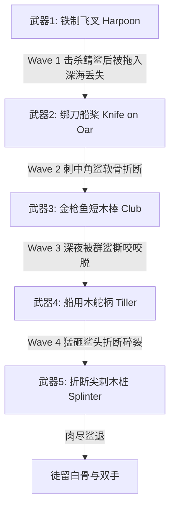

# 《老人与海》Unity Web 游戏系统机制、道具生态与原著台词全鉴 (Game Systems & Compendium)

> 本文档详尽提炼《老人与海》原著中出现的所有生存数值、物理拉锯力学、装备合成与损耗逻辑、海洋生物生态图鉴，以及原著中英双语对白与心理独白全集，为 Unity 程序员与关卡策划提供落地的数据与机制字典。

---

## 目录
1. [核心玩法力学与数值系统](#1-核心玩法力学与数值系统)
   - 1.1 [深海钓线张力力学系统 (Tension & Friction Physics)](#11-深海钓线张力力学系统-tension--friction-physics)
   - 1.2 [老人真实生理与负面状态系统 (Physiological Metrics)](#12-老人真实生理与负面状态系统-physiological-metrics)
   - 1.3 [意志力与记忆殿堂系统 (Willpower & Memory Buffs)](#13-意志力与记忆殿堂系统-willpower--memory-buffs)
2. [武器、工具与装备损耗树 (Weapons & Degradation Tree)](#2-武器工具与装备损耗树-weapons--degradation-tree)
3. [原著全海洋生物图鉴与游戏生态交互 (Marine Compendium)](#3-原著全海洋生物图鉴与游戏生态交互-marine-compendium)
4. [全书经典中英双语台词与独白文库 (Bilingual Quotes Library)](#4-全书经典中英双语台词与独白文库-bilingual-quotes-library)

---

## 1. 核心玩法力学与数值系统

### 1.1 深海钓线张力力学系统 (Tension & Friction Physics)

在 Unity 中，钓线拔河（Tug-of-War）是核心玩法循环。基于原著细节，老人**绝不能把钓绳死系在船桩上**，必须由人体后背作为减震弹簧，并用双手控制微摩擦出线。

```text
[张力状态机分布 (Tension Gauge: 0 - 100%)]
  0% ────────── 30% ────────────── 75% ────────────── 90% ────────── 100%
  [虚线松脱危险区]     [安全耐力消耗区]       [高负荷僵持区]     [断线临界区]
   Slack Warning      Optimal Fatigue         Strain/Cramp      Snap Danger
```

* **物理参数与判定逻辑**：
  - **张力值 (Tension $T \in [0, 100]$)**：由大鱼向前的拖拽速度 $V_{fish}$、小船阻力、以及玩家出线阻尼系数 $D$ 共同决定：
    $$T = \alpha \cdot (V_{fish} - V_{skiff}) + \beta \cdot D$$
  - **虚线警告 (Slack < 30%)**：若钓线过松，大鱼会甩头吐出弯钩。若持续 3 秒处于此区间，脱钩判定失败。
  - **安全区域 (30% - 75%)**：大鱼缓慢消耗体力，老人平稳受力。
  - **高负荷区 (75% - 90%)**：大鱼急剧消耗体力，但老人的“后背勒伤值”累加，左手抽筋发生概率每秒递增 2.5%。
  - **断线临界区 (90% - 100%)**：钓线发出高频嗡鸣（Line Hum），伴随屏幕剧烈抖动；必须立刻轻点**“松线/让线（Give Slack）”**滑行释放几码储备线，否则瞬间崩断，游戏失败。
* **储备线管理 (Line Capacity)**：
  - 主线：100 寻（约 183 米）。
  - 储备线：两卷各 40 寻（约 73 米）编织细线 + 船艏两卷备用大线（共 160 寻）。
  - 总线长达到 380 寻。若储备线全部耗尽出线完毕，大鱼逃逸。

---

### 1.2 老人真实生理与负面状态系统 (Physiological Metrics)

游戏抛弃简单的单一血条，采用原著严谨的**四维硬派生存体征**：

| 体征属性 | 初始值 | 衰减/变动条件 | 影响与惩罚 | 恢复方式 |
| :--- | :--- | :--- | :--- | :--- |
| **体力 (Stamina)** | 100 | 拉线、划桨、摇晃维持平衡每秒消耗 0.5 - 2 点 | 低于 20% 时无法阻止大鱼拖拽，收线速度下降 70% | 咀嚼生鱼肉（金枪鱼/鲯鳅片）、短时间闭目打盹 |
| **水分 (Hydration)** | 100 | 热带烈日暴晒、出汗每分钟衰减 3 点 | 低于 30% 时画面出现重度白内障式眩光，口干舌燥，反应窗口缩短 50% | 饮用船底棕色玻璃水瓶中的淡水（全游戏仅限 5 口） |
| **手部伤情 (Hand Health)** | 100 | 鱼急冲时钓线勒割右手掌扣除 15 点；强拉线磨损 | 右手流血导致抓握力下降；引来微量鲨鱼气味预兆 | 浸入清凉海水中盐疗（Salt Water Soak）止血结痂 |
| **神志清醒度 (Clarity)** | 100 | 长时间缺乏睡眠、眩晕黑视出现（Black Spots） | 低于 40% 视野出现幻觉，心跳杂音，方向感反转 | 触发“狮子记忆”或“卡萨布兰卡掰手腕回忆”QTE |

#### 特殊负面状态：左手抽筋 (Calambre)
* **原著还原**：第 86 天清晨，老人的左手因受凉与肌肉紧绷，手指无意识猛烈蜷缩成一具坚硬的死鹰爪。
* **游戏表现**：
  - 触发时屏幕左侧弹出痉挛警告，左手控制键失效，操作退化为单手操作（张力容错窗口收窄 60%）。
  - **化解小游戏**：
    1. 用右手取下小刀切开生金枪鱼肉，送入嘴中细嚼下咽（提供动物蛋白与盐分）；
    2. 将痉挛手掌摊在晨光照射的船头上，借日光回暖；
    3. 在拉线空档快速单手搓揉掌心经络，等待痉挛条清零。

---

### 1.3 意志力与记忆殿堂系统 (Willpower & Memory Buffs)

在老人濒临肉体崩溃的瞬间（体力 < 15% 或 出现黑斑昏厥），游戏暂停现实时间，切入黑白/复古棕褐色的**记忆殿堂（Memory Palace）**：

1. **记忆一：卡萨布兰卡酒馆决斗 (Arm-Wrestling at Casablanca)**
   - **原著背景**：年轻时在卡萨布兰卡港口酒馆，与先富埃戈斯最强大的码头黑人拳手掰手腕，从周日早晨持续到周一清晨（整整 24 小时），裁判每 4 小时轮换一次，两人指甲缝隙渗出血染红木桌，最终圣地亚哥爆发决胜，赢得“冠军（El Campeón）”尊号。
   - **机制效果**：完成节拍 QTE，立刻赋予**【冠军之力 (El Campeón Buff)】**—— 30 秒内体力锁定不扣除，抓握力翻倍。
2. **记忆二：伟大的乔·迪马吉奥与脚跟骨刺 (The Great DiMaggio)**
   - **原著背景**：老人崇拜纽约洋基队的棒球巨星迪马吉奥。迪马吉奥忍受着脚跟骨刺（bone spur）如钢针刺骨般的剧痛依然上场击出制胜球。
   - **机制效果**：手部伤情惩罚暂时免疫，张力控制精度提升 50%。
3. **梦境：非洲金色海滩的群狮 (The Lions on the Beach)**
   - **原著背景**：老人青年时代随三桅帆船去过非洲西海岸，暮色苍茫中看见金色海滩上嬉戏的小狮子，那是他一生宁静、纯真与勇气的象征。
   - **机制效果**：在夜晚短打盹阶段触发，神志清醒度（Clarity）瞬间回满，清除所有眩晕黑斑。

---

## 2. 武器、工具与装备损耗树 (Weapons & Degradation Tree)

随着游戏推进至第 5 幕（鲨鱼围攻），玩家的防卫武器呈现**不可逆转的阶梯式碎裂降级**，极致还原原著的悲壮宿命感：



### 武器属性明细表

| 装备名称 | 来源/改装方式 | 攻击方式 | 伤害力 | 耐久度/丢失机制 | 原著出处 |
| :--- | :--- | :--- | :--- | :--- | :--- |
| **生锈铁鱼叉 (Harpoon)** | 船载初始装备 | 蓄力长距离投掷 | 150 (极高) | 仅限 1 次。击毙首只灰鲭鲨后，随下沉鱼尸带走40英尺绳索沉海。 | *“He took the harpoon and the rope... the shark sank into the water.”* |
| **绑刀船桨 (Knife on Oar)** | 将唯一的水手短刀用粗绳死死绑在一柄木桨柄上 | 中距离双手戳刺 | 85 (良好) | 耐久 2 次。刺杀两只角鲨后，刀身受横向骨骼剪切力应声折断。 | *“The blade snapped when it hit the bone.”* |
| **敲鱼短木棒 (Club)** | 船艏常备用来敲死金枪鱼的结实硬木棍 | 近战向下猛砸 | 45 (中等) | 耐久 5 次。在夜间鲨群近身搏杀中，被大鲨鱼侧身猛咬带入水中脱手。 | *“The club was torn from his hand.”* |
| **原木舵柄 (Tiller)** | 徒手从小船舵板上拆卸下的转向木柄 | 双手重型挥击 | 35 (中等) | 猛砸数次后从中断裂，失去舵手控制权。 | *“He pulled the tiller free from the rudder.”* |
| **折断残刺 (Splintered Tiller)** | 舵柄折断后留下的带刺尖头断木 | 极限近距离反手刺 | 20 (微弱) | 撑至黎明群鲨退散，仅存一把木屑。 | *“He thrust the sharp end into the shark's eye.”* |

---

## 3. 原著全海洋生物图鉴与游戏生态交互 (Marine Compendium)

### 3.1 核心目标生物

* **巨大大西洋蓝马林鱼 (The Giant Atlantic Blue Marlin)**
  - **尺寸与外观**：体长 18 英尺，体侧布有淡紫色（Lavender）光辉横纹，长达数英尺的锋利剑喙，巨型新月尾。
  - **生态价值**：老人的兄弟与对手。死后可售卖巨额金钱，是港口从未见过的神话级渔获。
* **灰鲭鲨 (Mako / 原著称 Dentuso)**
  - **生态特征**：真正的海中杀手，游速可达 60 节。拥有完美的深青蓝色流线型背部，八排向内弯曲如人爪的利齿。
  - **行为模式**：不食腐，只冲着最鲜活的马林鱼肉高速直线冲击。
* **犁头角鲨 / 铲鼻鲨 (Galano / Brown Scavengers)**
  - **生态特征**：成群活动的棕黄色恶臭食腐鲨，头部扁平如宽铲，胸鳍如铁锹，眼球浑浊呈病态浅黄色。
  - **行为模式**：狡诈成双入对，潜伏在船底死角撕扯马林鱼下腹部。

### 3.2 海洋辅助与环境生物

* **鲯鳅 (Dolphin / Dorado)**
  - **原著特征**：金绿色、死前会急速变幻体色的飞跃捕食者。
  - **游戏机制**：老人用备用小线捕捉，生食恢复 40 点体力与 20 点水分；剖开其腹部可获得小飞鱼道具。
* **飞鱼 (Flying Fish)**
  - **原著特征**：老人在茫茫深海中最好的朋友与陪伴者。
  - **游戏机制**：海面出现飞鱼跃起滑翔时，预示着下方有大鱼或掠食者经过（作为追踪声纳）。
* **长鳍金枪鱼 (Albacore / Bonito)**
  - **原著特征**：重约 10 磅的小型金枪鱼。
  - **游戏机制**：出航初期钓获，切成红肉肉条作为大马林鱼的深海重饵与老人的应急干粮。
* **僧帽水母 (Portuguese Man-of-War / 原著称 Agua Mala)**
  - **原著特征**：如同彩虹般漂浮在海面的紫红色气囊水母，拖着数十英尺具有剧毒的刺丝触须。
  - **游戏机制**：海面障碍物。老人痛恨其虚伪美丽（“你这婊子”）。小木船掠过触须可能导致钓线粘连毒液，造成手部中毒灼痛。
* **军舰鸟 (Man-of-war Bird)**
  - **原著特征**：盘旋在热带上空的黑色剪刀尾海鸟，视力极佳。
  - **游戏机制**：空中罗盘。玩家追踪低空俯冲的军舰鸟即可定位鱼群与洋流交汇点。
* **海龟 (Turtles: Loggerheads / Leatherbacks / Hawksbills)**
  - **原著特征**：老人常年捕龟，对其既同情又喜爱；曾以喝白龟蛋补充体力。
  - **游戏机制**：偶尔游过船舷，老人与其低语交流，缓慢抚慰老人的心理压力。
* **疲倦的林莺 (The Tired Warbler)**
  - **原著特征**：从北方迁徙穿越海洋的小候鸟，落在大鱼拉紧的钓线上休息片刻。
  - **游戏机制**：叙事交互事件，短暂停留后因大鱼冲刺而飞向未知的天空。

---

## 4. 全书经典中英双语台词与独白文库 (Bilingual Quotes Library)

本台词库严格根据原著原句摘录，已按照游戏中具体的触发阶段打上标签，便于 Unity UI 文本框与画外音（Voiceover）调用。

### 4.1 启航与信念 (Prologue & Act I)
1. **关于运气与准备**
   - **EN**: *“It is better to be lucky. But I would rather be exact. Then when luck comes you are ready.”*
   - **ZH**: “运气好固然好。但我宁愿做到分毫不差。这样，当运气来临的时候，你已经做好了准备。”
   - **触发时机**：第 1 幕老人校准百寻钓线深度时。
2. **对大海母亲的爱**
   - **EN**: *“He always thought of the sea as ‘la mar’ which is what people call her in Spanish when they love her... as something that gave or withheld great favours.”*
   - **ZH**: “他总是把海称作‘la mar’，这是人们深爱大海时在西班牙语里对她的尊称……她赋予恩惠，抑或吝啬不予。”
   - **触发时机**：拂晓小艇驶入深蓝墨西哥湾流时。

### 4.2 对峙与痛苦 (Act II & Act III)
3. **左手抽筋的愤怒**
   - **EN**: *“What kind of a hand is that,” he said. “Cramp then if you want. Make yourself into a claw. It will do you no good.”*
   - **ZH**: “你这算是什么手，”他说。“你想抽筋就抽吧。变成一只鹰爪吧。这对你可一点好处也没有。”
   - **触发时机**：第 2 幕左手痉挛爆发时。
4. **对大鱼的爱与杀意**
   - **EN**: *“I love you and respect you very much. But I will kill you dead before this day ends.”*
   - **ZH**: “我非常爱你，也极其尊敬你。但今天太阳落山之前，我一定要把你杀死。”
   - **触发时机**：第 2 幕大鱼在深海持续拖拽小船时。
5. **对孤独与男孩的思念**
   - **EN**: *“I wish the boy were here,” he said aloud. “I’m being towed by a fish and I’m the towing bitt.”*
   - **ZH**: “真希望那个男孩在这儿，”他大声说，“我被一条鱼拖着走，而我自己成了拴缆绳的木柱。”
   - **触发时机**：夜晚繁星初上、体力告急时。

### 4.3 决战与破晓 (Act IV)
6. **超越死亡的尊严**
   - **EN**: *“You are killing me, fish, the old man thought. But you have a right to. Never have I seen a greater, or more beautiful, or a calmer or more noble thing than you, brother. Come on and kill me. I do not care who kills who.”*
   - **ZH**: “鱼啊，你这是要折磨死我，老人想。但这是你的权利。兄弟，我生平从未见过比你更庞大、更美丽、更平静或更高贵的生灵。来吧，杀死我吧。我不在乎谁杀了谁。”
   - **触发时机**：第 4 幕大鱼同心圆回旋、老人黑视眩晕濒危时。

### 4.4 鲨鱼围攻与核心硬汉宣言 (Act V)
7. **全书最高文学母题 (Core Thematic Apex)**
   - **EN**: *“Man is not made for defeat,” he said. “A man can be destroyed but not defeated.”*
   - **ZH**: “人不是为了失败而生的，”他说，“一个人可以被毁灭，但绝不能被打败。”
   - **触发时机**：第 5 幕第一尾灰鲭鲨被击毙但带走唯一鱼叉的绝境时刻。
8. **关于希望与罪孽**
   - **EN**: *“It is silly not to hope, he thought. Besides I believe it is a sin.”*
   - **ZH**: “失去希望是愚蠢的，他想。况且，我相信放弃希望本身就是一种罪过。”
   - **触发时机**：武器折断、夜间鲨群水波出现时。

### 4.5 归港与不朽余波 (Act VI & Epilogue)
9. **面对命运的坦荡**
   - **EN**: *“They beat me, Manolin,” he said. “They truly beat me.” / “He didn’t beat you. Not the fish.” / “No. Truly. It was afterwards.”*
   - **ZH**: “它们打败了我，马诺林，”他说，“它们真的打败了我。” / “它没有打败你。那条鱼没有。” / “是的。确实没有。是后来的事。”
   - **触发时机**：第 6 幕老人醒来喝男孩送来的热咖啡时。
10. **重拾出海的誓言**
    - **EN**: *“The hell with luck,” the boy said. “I’ll bring the luck with me.”*
    - **ZH**: “去它的运气，”男孩说，“我会把运气带来的。”
    - **触发时机**：男孩在床前与老人立誓重回大海时。
11. **最终落幕**
    - **EN**: *“Up the road, in his shack, the old man was sleeping again. He was still sleeping on his face and the boy was sitting by him watching him. The old man was dreaming about the lions.”*
    - **ZH**: “沿着大路上去，在那间棚屋里，老人又睡着了。他依然脸朝下趴着睡，男孩坐在旁边守望着他。老人正梦见那些狮子。”
    - **触发时机**：游戏通关制作人员名单滚动、终局结算画面。
