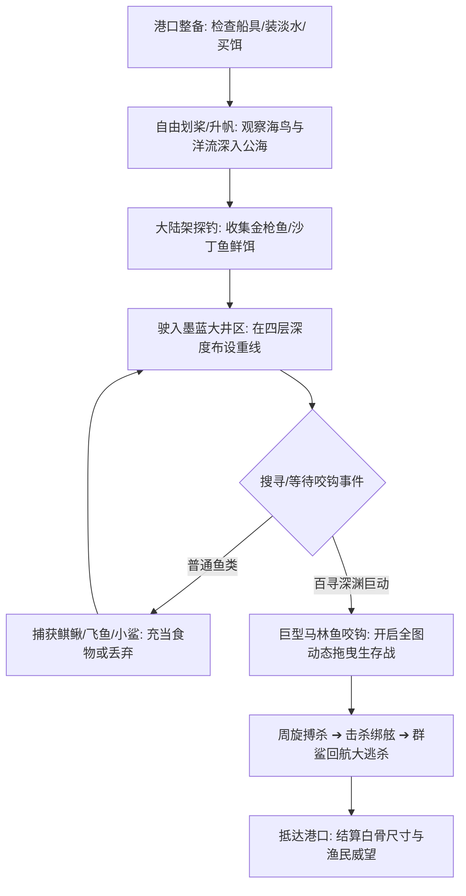

# 《老人与海》Unity Web 开放海域探索游戏设计案 (Open-Sea Exploration GDD)

> 本文档将《老人与海》原著世界重构为**开放海域航海探索与动态生态演化系统（Open-Sea Navigation & Dynamic Ecology）**。
> 灵感参考：《Dredge》（微克苏鲁拟真海钓）、《Sailwind》（无UI写实硬核帆船航海）、《Subnautica》（深渊巨物压迫感）。
> 核心体验：无GPS、无小地图指针。玩家依靠星宿、洋流、海鸟与海色在开阔的墨西哥湾流中自由寻踪、下饵、深海博弈，并在巨鱼咬钩后转入全图动态拖曳生存。

---

## 目录
1. [开放海域空间架构与区域划分 (World Map & Ocean Zones)](#1-开放海域空间架构与区域划分-world-map--ocean-zones)
2. [拟真环境辨识与无UI写实导航 (Diegetic Navigation System)](#2-拟真环境辨识与无ui写实导航-diegetic-navigation-system)
3. [自由探索与动态深渊生态循环 (Exploration Gameplay Loop)](#3-自由探索与动态深渊生态循环-exploration-gameplay-loop)
4. [从自由漫游到“动态全图拖曳”无缝切换 (Seamless State Transition)](#4-从自由漫游到动态全图拖曳无缝切换-seamless-state-transition)
5. [小艇微观拟真交互与生存系统 (On-Deck Micro Interaction)](#5-小艇微观拟真交互与生存系统-on-deck-micro-interaction)
6. [海面突发事件与生态遭遇池 (Dynamic Ocean Encounters)](#6-海面突发事件与生态遭遇池-dynamic-ocean-encounters)
7. [Unity WebGL 开放海域技术优化方案 (Technical Constraints & Performance)](#7-unity-webgl-开放海域技术优化方案-technical-constraints--performance)

---

## 1. 开放海域空间架构与区域划分 (World Map & Ocean Zones)

游戏世界由一片约 $8 \times 8$ 平方公里的连续无缝开放海域构成。海底地形、水色纯度与生物生态由近岸至深渊阶梯式展开：

```text
[开放海域纵深分布俯视图]

[北部深渊区：远洋禁区 / Afuera Abyss] (深度 200+ 寻)
    * 终极马林鱼栖息地 / 狂暴黑潮 / 鲨鱼深海巡游走廊 / 陆地彻底隐没
─────────────────────────────────────────────────────────────
[中部断崖区：墨西哥湾流大井 / The Great Well] (深度 100 - 150 寻)
    * 墨黑-靛青分界线 / 巨型鲯鳅群 / 大马林鱼咬钩高发带
─────────────────────────────────────────────────────────────
[大陆架浅海区：捕饵与巡航水域 / Continental Shelf] (深度 20 - 75 寻)
    * 翡翠绿海水 / 飞鱼跃迁 / 沙丁鱼潮 / 军舰鸟盘旋 / 偶尔见其他渔船
─────────────────────────────────────────────────────────────
[南部海岸港湾区：科希马尔安全港 / Cojimar Bay] (深度 0 - 15 寻)
    * 露台饭店码头 / 鲨鱼加工厂海湾 / 老人草棚木屋 / 男孩马诺林补给点
```

### 四大区域生态与参数表

| 区域代码 | 区域名称与原著锚点 | 水深与海流 | 视觉特征与色调 | 核心游玩内容与生态 |
| :--- | :--- | :--- | :--- | :--- |
| **Zone 0** | **科希马尔避风港 (Cojimar Safe Bay)** | 2 - 10 寻 (3-18米)<br>平缓内湾潮流 | 泛黄碧波、岸边白色碎石滩、渔村煤油灯微光 | 自由进出港湾、与男孩对话采购鱼钩/沙丁鱼/淡水、向年长渔夫打探水文谣传、修补残帆。 |
| **Zone 1** | **大陆架浅海浅绿区 (The Green Flats)** | 20 - 75 寻 (36-137米)<br>温和西向沿岸流 | 绿白相间浅海、大片漂浮马尾藻（Sargasso weed） | 搜寻飞鱼群、抛手线钓获长鳍金枪鱼（Bonito）和沙丁鱼作为深海重饵、规避僧帽水母毒丝。 |
| **Zone 2** | **墨西哥湾流大井区 (The Great Well)** | 100 - 150 寻 (183-275米)<br>强劲北向湾流 (2.5节) | 海水由青绿骤降为幽邃纯黑靛蓝（Deep Indigo），海面泛起长涌浪 | 设下多层垂直钓线（40/75/100/125寻）、捕获大鲯鳅（Dorado）、辨识百寻深处的试探性颤动。 |
| **Zone 3** | **远洋禁区·阿富埃拉 (Afuera Abyss)** | 200+ 寻 (360米以上)<br>深海逆流、狂暴微气团 | 极夜海域仅有荧光浮游生物与猎户座星光，海天彻底相融 | 巨型大马林鱼的隐秘领域。风险：一旦在此咬钩，小船将被长途拖曳数百里，返航极为凶险。 |

---

## 2. 拟真环境辨识与无UI写实导航 (Diegetic Navigation System)

彻底移除现代小地图与雷达航标，所有航行与渔业信息完全融入第一人称/近景第三人称**视听觉感知**：

### 2.1 天文与地平线导向 (Celestial Navigation)
* **夜间方位定位**：
  - **哈瓦那夜空反光 (Havana Sky Glare)**：夜间望向西南方向，地平线尽头有一片微弱温暖的橘黄色城市光晕。只要光晕可见，老人便知晓大陆方向。
  - **猎户座腰带与参宿七 (Belt of Orion & Rigel)**：午夜正南方高悬的三颗明亮星宿与冰蓝的参宿七，指引正南方归途。
  - **晨星金星 (Morning Star / Venus)**：黎明前东方最耀眼的白星，提示破晓即将来临。
* **白昼陆地辨识**：
  - **积雨云形态 (Land Clouds)**：海面上空的平坦积云在陆地上方会垂直堆叠成高耸的棉花团状（Cumulus towers over island），提示下方是古巴岛。

### 2.2 海色与洋流感官读图
* **海水色阶透光度**：
  - 绿色/灰绿透明度高 ➔ 大陆架浅滩，安全但无巨鱼。
  - 极深纯靛黑蓝色 ➔ 已驶入墨西哥湾流深水核心区（The Stream），浮力变大、涌浪变长，深海物种活跃。
* **马尾藻海草带 (Sargasso Weed)**：
  - 海面浮现成片发黄的细碎马尾藻带，预示深层洋流交汇；夜间船桨划碎海草带会激荡起明亮的绿色生物发光（Phosphorescence）。

### 2.3 自然生灵作为活体雷达 (Organic Radar)
* **黑剪刀尾军舰鸟 (Frigate Bird Tracking)**：
  - 看到远方高空有一只黑色海鸟在低空盘旋俯冲，代表下方海面有鲯鳅正在追逐飞鱼。跟随海鸟航向必能找到生鲜鱼饵。
* **飞鱼跃迁方向**：
  - 成群飞鱼破浪贴海滑翔数十码，其逃窜的相反方向通常存在巡游的大型捕食者（大鲯鳅或马林鱼）。

---

## 3. 自由探索与动态深渊生态循环 (Exploration Gameplay Loop)



### 3.1 开放式垂钓与多深度垂钓系统 (Multi-Depth Free Rigging)
玩家不再只是按单键垂钓，而是在小船上操控四组独立钓绳：
* **40 寻（浅层）**：悬挂小型沙丁鱼，常引诱飞鱼群与中小型鲯鳅。
* **75 寻（中层）**：悬挂鲜金枪鱼条，针对大型成年鲯鳅与游弋的梭子鱼。
* **100 寻（深渊井口）**：用一整条新鲜鲜带血长鳍金枪鱼包裹大号钢钩（尾部双钩贯穿），是大马林鱼的必杀诱饵。
* **125 寻（冥府深渊）**：探入深海冷水层，易引来深海巨型海龟或潜伏的底层恶鲨。

每个钓绳都在船舷别有一根纤细绿树枝（Green sapling stick）。玩家在船上自由走动或打盹时，需根据**树枝的下弯弧度与轻弹频率**，实时判断哪一根深度有鱼咬饵。

---

## 4. 从自由漫游到“动态全图拖曳”无缝切换 (Seamless State Transition)

在传统关卡制中，打 Boss 是进入封闭副本；在开放海域探索版中，**“大鱼咬钩”意味着大鱼夺取了小船的航向控制权**：

### 4.1 全图动态洋流拖行力学 (Dynamic Sea Drag Trajectory)
* 一旦大马林鱼在百寻深渊吞钩刺紧，小船立即失去自由划桨能力，转由大鱼拖动。
* **非线性全图游弋**：
  - 大鱼不是固定在原地打转，它拥有全局 AI 巡游权重：
    - **白天**：沿着墨西哥湾流背向太阳朝**东北方**以 2-3 节航速持续强力拖拽，将小船拉入更凶险的远海深渊；
    - **夜晚**：转向顺洋流缓速漂浮，逼近暗礁区或狂暴回流区。
* **玩家的自由度与挣扎**：
  - 玩家必须在船艏与船艉之间移动，实时调整钓绳搭在身体后的重心；
  - 玩家可选择在适当时机使用木桨充当舵，微调船身倾斜角度，迫使大鱼抵抗水流阻力，消耗其体力；
  - 但若强行往礁石带别舵，会导致大鱼暴怒腾跃或拉断钓绳。

### 4.2 陆地视距与迷失危机
* 随着拖曳持续两天两夜，陆地山峦彻底隐没。
* 玩家在雷雨交加的夜晚只能依靠西方微弱的哈瓦那黄光判断偏移量。若拖出地图边界暴风雨区，将面临巨浪倾覆船只的严酷生存考验。

---

## 5. 小艇微观拟真交互与生存系统 (On-Deck Micro Interaction)

16 英尺的小木船即是玩家的全部微观世界。玩家可在船舱内全自由物理交互：

```text
[小艇俯视交互布设图]
┌──────────────────────────────────────────────┐
│                    [船艏 Bow]                │
│  - 卷起备用线篮 (Lines Basket)               │
│  - 铁鱼叉与系缆绳 (Harpoon & Coil)           │
│  - 观察水面动向站立点 (Observation Point)    │
├──────────────────────────────────────────────┤
│                   [船中 Midship]             │
│  - 桅杆与可升降补丁帆 (Mast & Canvas)        │
│  - 双木桨与划桨座 (Oars & Rowlocks)          │
│  - 饵料盐箱 (Bait Box with Coarse Salt)      │
│  - 淡水玻璃瓶 (Water Bottle: 限5口)          │
├──────────────────────────────────────────────┤
│                    [船艉 Stern]              │
│  - 木舵板与可拆卸木舵柄 (Rudder & Tiller)    │
│  - 杀鱼短硬木棍 (Club)                       │
│  - 备用拖钓短线 (Handlines)                  │
│  - 生鱼剔肉切板 (Cutting Board)              │
└──────────────────────────────────────────────┘
```

* **微观生存操作行为**：
  - **割肉切片**：拿起水手短刀，对准船底的金枪鱼或鲯鳅划出肉条，直接生吃充饥。
  - **海水浸手**：蹲在船舷将流血红肿的双手浸入清凉海水中，看着盐水洗去血丝，缓慢恢复握力。
  - **甲板打盹 (Micro-Sleep)**：在没有剧烈咬钩时，将钓线压在肩下，趴在船板报纸上闭目小憩（时间流速加快 10 倍，清醒度与体力快速回升，但若突发大鱼发力需瞬间惊醒按键防脱钩）。

---

## 6. 海面突发事件与生态遭遇池 (Dynamic Ocean Encounters)

在开放海域探索航行期间，系统动态派发基于原著细节的自然事件：

| 事件名称 | 出现海域与条件 | 视听觉呈现 | 玩家抉择与机制后果 |
| :--- | :--- | :--- | :--- |
| **僧帽水母繁衍带 (Agua Mala Bloom)** | 大陆架浅海、正午平静无风 | 海面漂浮大片晶莹剔透如虹彩般的紫红色气囊，长触须拖拽十数米 | 视觉极度华美但剧毒。若小船划入，钓线粘上毒液会灼伤手掌；可用木桨拍碎气囊泄愤。 |
| **疲倦的小林莺 (Tired Warbler)** | 远洋深渊区、第二日黄昏 | 一只体型微小的北方黄林莺在船周盘旋三圈，最后轻落紧绷的钓线上 | 纯情感交互。老人可与其轻声对话；林莺歇息片刻后振翅飞离，赋予老人短时精神平静 Buff。 |
| **友善海龟偶遇 (Loggerhead Turtle)** | 墨西哥湾流边缘、清晨 | 一只巨大的黄色笨拙蠵龟游过船侧，好奇地啃食漂浮的黄海草与水母 | 带来平和氛围，降低老人的躁狂度；海面平静度小幅上升。 |
| **飞鱼跃上甲板 (Flying Fish Leap)** | 任何深水区、夜间高速漂流 | 伴随水花破裂声，一条银蓝色发光飞鱼在半空折射，扑腾跌落在船舱里 | 意外收获！可直接拾取并作为无需加工的优质生鱼点心或极佳备用诱饵。 |
| **突发暴烈狂风 (Brisa Squall)** | 远海深渊、归航途中 | 东方海面骤暗，狂风吹乱波浪，气温剧降，船舷进水 | 必须立刻降下补丁帆，紧扣船舵迎浪航行，并在颠簸中小舀舱底积水，避免小船侧翻沉没。 |
| **同行捕鲨船擦肩 (Passing Smacks)** | 靠近港湾 1-2 公里处 | 远方出现汽油机动马林渔船或大型捕鲨平底船，引擎轰鸣，飘来雪茄烟草味 | 强烈的时代反差。对方渔夫在远方呼喊询问，老人可挥手致意，体验孤独与人类社会的距离。 |

---

## 7. Unity WebGL 开放海域技术优化方案 (Technical Constraints & Performance)

为确保游戏在浏览器端流畅稳定运行（60 FPS @ WebGL 2.0，首包体积 $\le 30\text{MB}$）：

1. **无尽海洋渲染 (Infinite Ocean via Projected Grid)**：
   - 不采用大面积实体 Mesh。使用一套围绕摄像机投影的自适应屏幕网格（Projected Grid），结合轻量 Gerstner Waves 顶点置换，单水体渲染仅占 1 次 Draw Call。
2. **生物与物体浮力仿真 (Buoyancy Job System)**：
   - 小艇使用 4 点水面高度采样模拟四角浮力物理，配合 Unity C# Job System 计算，无垃圾回收（Zero-GC Allocations）保证航行不卡顿。
3. **层次距离剔除与天象渲染 (LOD & Skybox)**：
   - 远景海浪简化为法线贴图扰动；
   - 星空、哈瓦那光晕、云雾完全集成于 Procedural Skybox Shader 中，彻底免除高开销的光照贴图（Lightmaps）。
4. **音频氛围音景流式加载 (Streaming Ambience)**：
   - 海风呼啸、船板木头挤压声、海浪拍击船舷声采用 Web Audio API 多层循环淡入淡出，包体音频资源压缩在 3MB 以内。
