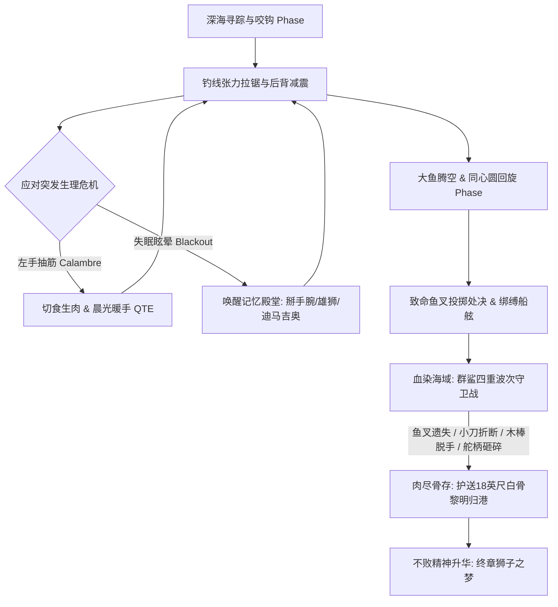

# 《老人与海》Unity Web 游戏全案设计与资产策划索引库 (Master Game Design Docs)

> 本文档库严格依据项目根目录 `docs/oldmansea.pdf`（欧内斯特·海明威原著完整文本）提炼构建，为 Unity Web 游戏项目提供从视觉资产生成、AI 对话提示词、关卡流程编排到物理力学数值的落地技术全案。

---

## 📚 文档矩阵概览

| 模块文件 | 核心内容与职能 | 适用人群/工具链 |
| :--- | :--- | :--- |
| [**01_PROMPT_LIBRARY.md**](./01_PROMPT_LIBRARY.md) | **大鱼与老人 AI 提示词与资产库** • 老人圣地亚哥与大马林鱼外貌设定、2D/3D概念图Prompt（Midjourney v6/SDXL） • Unity PBR材质与次表面散射 (SSS) Shader规范 • 角色 Animator 动作状态机定义 • Unity LLM 端侧/API 心理独白系统 System Prompt • 鲨鱼敌人 (Mako / Galano) 概念与 AI 状态机 | 美术设计、3D建模师、AI生成工作流、技术美术 (TA) |
| [**02_STORYLINE_AND_LEVEL_PROGRESSION.md**](./02_STORYLINE_AND_LEVEL_PROGRESSION.md) | **全主线叙事与关卡推进设计方案** • 7幕式关卡结构（第0幕序章 ~ 第6幕尾声） • 84日厄运破除、百寻深渊咬钩、无声深海拖曳、巨兽破水腾跃、生死回旋处决、四波鲨鱼攻防、未败残骸归港 • 关卡目标、过场演出、QTE判定与心流曲线 | 游戏主策划、关卡设计师、叙事编剧 |
| [**03_GAME_SYSTEMS_AND_MECHANICS.md**](./03_GAME_SYSTEMS_AND_MECHANICS.md) | **游戏系统机制、道具生态与台词全鉴** • 深海钓线张力物理学（Tension & Friction） • 老人四维生存体征（体力/水分/手伤/神志）与左手痉挛（Calambre）自愈小游戏 • 意志力与记忆殿堂（卡萨布兰卡掰手腕、迪马吉奥骨刺、海滩幼狮） • 武器阶梯式崩毁树（鱼叉 ➔ 绑刀桨 ➔ 短木棒 ➔ 破舵柄 ➔ 残刺） • 10种海洋生态生物交互全鉴 • 全书经典中英双语原著金句文库（带触发标签） | Unity 逻辑程序员、数值策划、音效设计 (SFX/VO) |

---

## 🎮 核心玩法闭环概览 (Core Game Loop)

---

## 🛠️ Unity Web 开发接入建议

1. **WebGL 性能与包体优化**：
   - 角色与马林鱼模型推荐使用 Stylized Realistic（风格化写实）风格，单模型面数控制在 15,000 面以内。
   - 水体 Shader 推荐采用基于顶点位移的轻量级 Gerstner Wave Shader，海水透光使用屏幕空间近似。
2. **AI 与动态叙事驱动**：
   - 文档 `01_PROMPT_LIBRARY.md` 中提供的 LLM System Prompt 可直接对接云端小模型或端侧 WebLLM（如 SmolLM / Llama-3.2-1B-Instruct），实现老人依据实时拉力、体力与天气生成的动态心理独白。
3. **数据驱动与本地化**：
   - 文档 `03_GAME_SYSTEMS_AND_MECHANICS.md` 中的中英双语台词库结构可直接转为 ScriptableObject 或 JSON 资产文件，挂载至游戏 DialogueManager 中。
